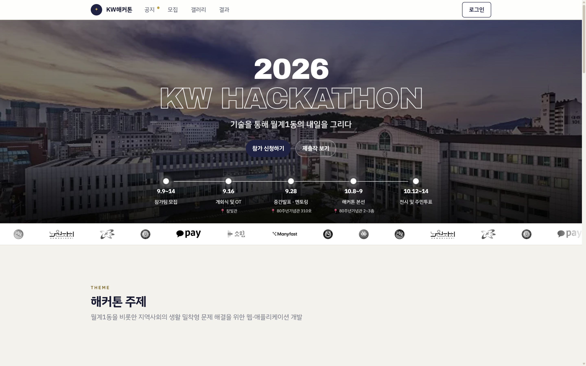
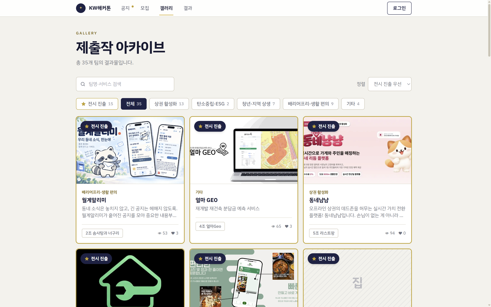
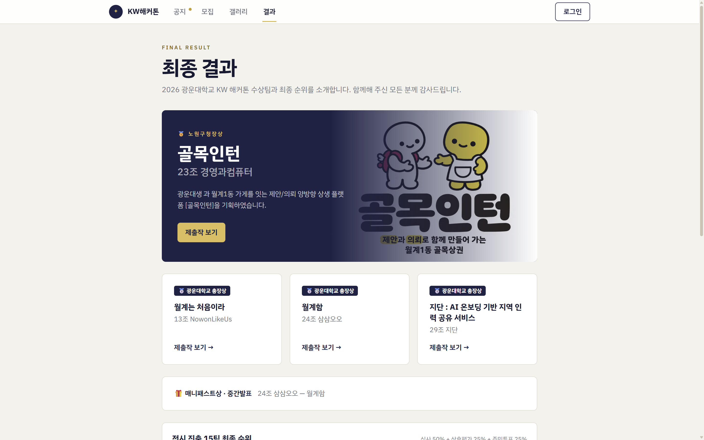

# 🏆 2026 광운대학교 KW 해커톤 운영 플랫폼

> **직접 주최한 해커톤을, 직접 만든 플랫폼으로 운영했습니다.**
> 참가 신청부터 팀 편성 · 제출 · 심사 · 결과 공개까지, 40팀 145명이 참가한 오프라인 해커톤의 전 과정을 하나의 웹 서비스로 통합해 1인 개발했습니다.

---

## 📊 한눈에 보기

| 145명 · 40팀 | 113명 | 4,564건 | 1,970회 | 2,112표 |
| :---: | :---: | :---: | :---: | :---: |
| 대회 참가 | 플랫폼 가입 | 팀 상호평가 채점 | 제출작 누적 조회 | 3일간 주민투표 |

- **플랫폼 가입 113명** — 팀장 39명 · 운영진 4명 외에 **70명이 자발적으로 가입**했습니다. 팀장뿐 아니라 팀원과 일반 방문자까지 직접 로그인해 사용한 플랫폼입니다.
- **팀 상호평가** — 결과물을 제출한 **35팀 전원**이 플랫폼에서 서로를 평가해 항목별 채점 4,564건이 쌓였습니다.
- **제출작 누적 조회 1,970회** — 같은 사람이 같은 작품을 여러 번 봐도 1회로 세는 중복 제거 기준입니다.
- **대회 결과** — 35팀 결과물 제출 → 15팀 전시 진출 → 주민투표 2,112표로 최종 수상팀 선정

- **대회**: 2026 광운대학교 KW 해커톤 — *"기술을 통해 월계1동의 내일을 그리다"* (지역 문제 해결 5개 트랙)
- **시상**: 노원구청장상 · 광운대학교 총장상 ×3 · 매니패스트상
- **대회 기간**: 2026.09.09 모집 → 10.14 전시 · 주민투표 (약 5주)
- **개발 기간**: 2026.07 ~ 2026.10 · 1인 개발 · 커밋 331개 · DB 마이그레이션 64개

---

## 🙋 나의 역할

인공지능융합대학 학생회 **하성 회장**으로 대회를 주최하면서, 운영 플랫폼의 **기획 · 개발을 혼자 맡고**, 대회 운영에 직접 사용했습니다.

- **기획** — 구글 폼 · 스프레드시트 · 단톡방에 흩어져 있던 운영 업무를 분석해 *참가자 · 운영진 · 전시장 주민* 세 역할의 화면으로 재설계
- **개발** — Next.js + Supabase 풀스택 구현, RLS 기반 권한 설계, PGlite로 DB 정책 자동 테스트
- **운영** — 대회 기간 동안 공지 · 팀 관리 · 제출 마감 · 점수 입력 · 결과 공개를 직접 운영하며 실시간으로 수정 배포

---

## 🎯 무엇을 해결했나

| 기존 운영 방식의 문제 | 플랫폼으로 바꾼 것 |
| :--- | :--- |
| 신청 · 팀 편성 · 제출물이 서로 다른 문서에 흩어져 대조가 필요 | **단일 DB**에서 팀장 이메일로 로그인하면 팀이 자동 연결 |
| 심사위원 종이 점수를 옮겨 적다 계산 실수 발생 | 채점표 입력 즉시 **평균 · 순위 자동 계산** |
| 중간 순위가 새면 이후 평가가 흔들림 | 종료 전까지 순위 · 득표를 **DB 권한으로 차단** |
| 공지 · 일정 변경이 단톡방에 묻힘 | **단계(phase) 스위치 하나**로 전 사이트 화면 전환 + 공지 게시판 |
| 대회가 끝나면 결과물이 흩어짐 | 35팀 제출작 **갤러리 아카이브** + 최종 결과 페이지 |
| 145명의 문의 · 팀원 모집이 개인 연락에 의존 | **팀원 모집 게시판** + 로그인 사용자에게만 연락처 공개 |

| 제출작 갤러리 | 최종 결과 |
| :---: | :---: |
|  |  |

---

## 💡 기술적 하이라이트

### 1. "화면에 안 보이면 안전하다"는 착각을 깨고 DB에서 막기
Supabase의 anon key는 공개 값이라, 누구나 REST API를 직접 호출할 수 있습니다. 실제로 점검해 보니
- 참가자 토큰으로 **자기 계정을 관리자로 승격**할 수 있었고 (컬럼 단위 revoke가 테이블 권한에 무시됨)
- 잠근 순위 뷰와 별개로 **주민 득표수 컬럼이 원본 테이블로 새고** 있었으며
- 모집글의 **연락처 · 응원 기록이 통째로 조회**됐습니다.

→ "전부 잠그고 필요한 컬럼만 여는" 방식으로 권한 모델을 다시 세우고, 막은 뒤 깨진 집계는 전용 뷰로 읽기 경로를 다시 설계했습니다. 이 과정이 마이그레이션 64개에 보안 이력으로 남아 있습니다.

### 2. 목(mock)이 아닌 진짜 Postgres로 보안 정책 테스트
RLS와 집계 로직은 목으로는 검증할 수 없어, **PGlite(인메모리 Postgres)** 에 실제 마이그레이션을 올려 권한 · 순위 · 마감 · 투표 로직을 `node --test`로 검증했습니다.

### 3. 대회 당일을 버티는 운영 설계
- 운영진이 만질 스위치를 **단계 하나 + 제출/수정 토글**로 줄여 실수 여지를 없앰
- 마감 후 제출물 수정을 **앱과 DB 정책 두 겹**으로 차단
- 가입 트리거 오류로 Google 로그인이 막혔던 장애를 원인 분석해, **인증을 막지 않는 트리거**로 수정
- 무료 티어 DB 자동 일시중단을 크론 헬스체크로 방지

### 4. 현장 상황에 맞춘 유연한 집계
전시 주민투표용 1회용 QR 투표권 시스템(기기 단위 중복 차단 포함)을 구현했지만, 실제 현장에서는 **코인 수동 투표**로 진행했습니다. 시스템을 고집하지 않고 외부 집계 결과(심사 50% · 상호평가 25% · 주민투표 25%)를 코드에 고정해 결과 페이지와 수상 배지에 반영했습니다.

---

## 🛠️ 기술 스택

| 구분 | 사용 기술 |
| :--- | :--- |
| Frontend | Next.js 16 (App Router, Server Components), React 19, TypeScript, Tailwind CSS |
| Backend | Next.js Server Actions · Route Handlers |
| Database | Supabase (PostgreSQL · Auth · RLS · 컬럼 GRANT · View) |
| Test | `node --test` + PGlite |
| Infra | Vercel (서울 리전, Cron), Supabase |

---

## 📝 배운 점

- **보안은 "가리기"가 아니라 "권한"이다.** 클라이언트에 키가 노출되는 구조에서는 최종 방어선을 DB에 둬야 한다는 걸 실제 취약점을 고치며 체득했습니다.
- **막는 것과 여는 것은 한 세트다.** 권한을 잠근 직후 응원 수 집계가 깨지는 회귀를 겪으며, 보안 조치를 할 때 읽기 경로까지 함께 설계하는 습관이 생겼습니다.
- **운영자가 곧 사용자다.** 주최자로서 직접 운영해 보니, 기능을 늘리는 것보다 당일에 잘못 누를 버튼을 줄이는 것이 더 중요했습니다.

---

## 📚 더 보기

- 📐 [개발 · 운영 문서](docs/DEVELOPMENT.md) — 아키텍처, 점수 산정 공식, 트러블슈팅 9건 상세, 실행 방법, 운영 매뉴얼
- 🏅 [최종 결과 페이지](https://hackathon-platform-sy04.vercel.app/results)
